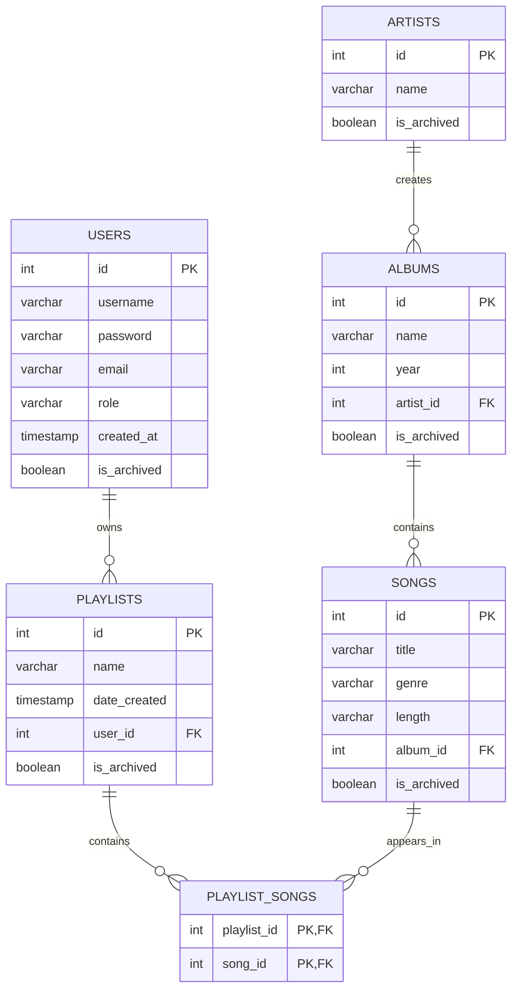

# 🎵 Recording Studio CLI App

A Java console application I developed for my **Programming (Java) NC III** coursework at Joysis Tech Voc Inc. It manages a recording studio's artists, albums, songs, users, and playlists using **Java 21**, **JDBC**, and a **MySQL/MariaDB** database.

I built the application around a three-tier architecture to separate console interaction, business rules, and database access. It also includes account registration, BCrypt authentication, role-based dashboards, and playlists that belong to the signed-in user. This is built as my final project capstone I.

## Table of Contents

- [Features](#features)
- [Tech Stack](#tech-stack)
- [Architecture](#architecture)
- [Project Structure](#project-structure)
- [Database Design](#database-design)
- [Use Cases and Roles](#use-cases-and-roles)
- [Getting Started](#getting-started)
- [Running the App](#running-the-app)
- [Sample Usage](#sample-usage)
- [Design Decisions](#design-decisions)
- [Testing](#testing)
- [Troubleshooting](#troubleshooting)
- [Author](#author)

## Features

### Catalog and user management (Admin)

- Create, view, search, update, archive, restore, and permanently delete **artists, albums, songs, and users**.
- Use menu-driven updates to change a selected field while keeping the other fields unchanged.
- Retrieve an active record by ID before updating it, using `findById()` in the Repository and Service layers.
- Display archived records before asking which record to restore.

### Playlist and catalog access (User)

- Browse active artists, albums, and songs, and search the song catalog.
- Create, view, rename, search, archive, restore, and delete **my own playlists**.
- Add songs to a playlist, view its songs, and remove songs through the `playlist_songs` junction table.
- Automatically use the authenticated user's ID when creating or managing a playlist, instead of prompting for a user ID.
- Restrict user-specific playlist queries and changes by playlist ownership.

### Authentication and console interface

- Register accounts with the default `USER` role; hash new passwords with **BCrypt**.
- Sign in with a username and password and display the authenticated account's username and role.
- Show separate `ADMIN` and `USER` dashboards.
- Validate blank input, invalid numbers, non-positive IDs, and other entity-specific fields.
- Truncate long values **for display only** and keep the full values in the database.
- Clear supported terminal screens using ANSI escape codes, with a pause so operation results remain readable.
- Use `PreparedStatement` with parameters for database operations involving user-provided values.

## Tech Stack

| Area | Technology |
|---|---|
| Language | Java 21 |
| Database | MySQL / MariaDB (`recording_studio_db`) |
| Database access | JDBC, SQL, `PreparedStatement`, try-with-resources |
| Build and dependencies | Maven |
| Password hashing | jBCrypt (`org.mindrot:jbcrypt:0.4`) |
| IDE used | IntelliJ IDEA |
| Interface | Console / CLI |

## Architecture

I organized the application into three tiers:

```text
         User input / console output
                    │
                    ▼
          ┌──────────────────┐
          │ View             │  Menus, prompts, tables
          └────────┬─────────┘
                   │
                   ▼
          ┌──────────────────┐
          │ Service          │  Validation, business rules
          └────────┬─────────┘
                   │
                   ▼
          ┌──────────────────┐
          │ Repository       │  SQL queries, JDBC, object mapping
          └────────┬─────────┘
                   │
                   ▼
               MySQL DB
```

The `model` package represents database entities, and `config/DbConnection.java` manages connections. `App.java` acts as the entry point and initializes the dependencies in order: **connection → repository → service → view**.

I use interfaces for repositories and services, with implementation classes handling the actual behavior. The Service layer validates inputs and delegates database operations to the Repository layer. Console messages are currently printed by both Views and some Services, which is an area I can refine in future versions.

## Project Structure

```text
b426-csp1-dichosa-immanuel/
├── pom.xml
├── src/
│   └── main/java/com/joysistvi/recordingapp/
│       ├── App.java                   # Application entry point
│       ├── config/
│       │   └── DbConnection.java
│       ├── model/
│       │   ├── Artist.java
│       │   ├── Album.java
│       │   ├── Song.java
│       │   ├── User.java
│       │   └── Playlist.java
│       ├── repository/
│       │   ├── ArtistRepository.java
│       │   ├── ArtistRepositoryImpl.java
│       │   ├── AlbumRepository.java
│       │   ├── AlbumRepositoryImpl.java
│       │   ├── SongRepository.java
│       │   ├── SongRepositoryImpl.java
│       │   ├── UserRepository.java
│       │   ├── UserRepositoryImpl.java
│       │   ├── PlaylistRepository.java
│       │   └── PlaylistRepositoryImpl.java
│       ├── service/
│       │   ├── ArtistService.java
│       │   ├── ArtistServiceImpl.java
│       │   ├── AlbumService.java
│       │   ├── AlbumServiceImpl.java
│       │   ├── SongService.java
│       │   ├── SongServiceImpl.java
│       │   ├── UserService.java
│       │   ├── UserServiceImpl.java
│       │   ├── PlaylistService.java
│       │   └── PlaylistServiceImpl.java
│       ├── view/
│       │   ├── ArtistView.java
│       │   ├── AlbumView.java
│       │   ├── SongView.java
│       │   ├── UserView.java
│       │   ├── PlaylistView.java
│       │   └── ConsoleOutput.java
│       └── main/
│           └── Main.java             # Older/legacy implementation
└── .idea/artifacts/                 # IntelliJ JAR artifact configuration
```

The application should be started from **`com.joysistvi.recordingapp.App`**. The separate `main/Main.java` is an older implementation and is not the current entry point.

## Database Design

**Database name:** `recording_studio_db`



| Table | Important columns |
|---|---|
| `artists` | `id`, `name`, `is_archived` |
| `albums` | `id`, `name`, `year`, `artist_id`, `is_archived` |
| `songs` | `id`, `title`, `genre`, `length`, `album_id`, `is_archived` |
| `users` | `id`, `username`, `password`, `email`, `role`, `created_at`, `is_archived` |
| `playlists` | `id`, `name`, `date_created`, `user_id`, `is_archived` |
| `playlist_songs` | `playlist_id`, `song_id` (composite primary key) |

A **User can have multiple Playlists** (one-to-many), and a Playlist can contain multiple Songs. The same Song can also appear in multiple Playlists, creating a many-to-many relationship through `playlist_songs`.

For simplicity, song duration is stored as text such as `3:45`. Archiving uses `is_archived = 1`; restoring sets it back to `0`. Some permanent deletes may be blocked by foreign-key relationships when records are still referenced elsewhere.

## Use Cases and Roles

The application has two roles:

| Action | `USER` | `ADMIN` |
|---|:---:|:---:|
| Register and log in | ✓ | ✓ |
| Browse artists, albums, and songs | ✓ | Through management menus |
| Search songs | ✓ | ✓ |
| Manage artist records | — | ✓ |
| Manage album records | — | ✓ |
| Manage song records | — | ✓ |
| Manage user records | — | ✓ |
| Manage own playlists | ✓ | — |
| Add / remove songs in own playlists | ✓ | — |

The account's role is read after login to decide which dashboard to show. Self-registration creates a `USER` account. The Admin dashboard is for catalog and account management, while the User dashboard is for browsing and personal playlist management.

## Getting Started

### Prerequisites

- JDK **21**
- A local MySQL or MariaDB server (for example, through XAMPP)
- Maven and IntelliJ IDEA, or another Java IDE with Maven support
- Git

### 1. Clone my repository

```bash
git clone https://github.com/DFimman/b426-csp1-dichosa-immanuel.git
cd b426-csp1-dichosa-immanuel
```

### 2. Set up the database

Create the database in phpMyAdmin or your SQL client:

```sql
CREATE DATABASE IF NOT EXISTS recording_studio_db;
```

Import the SQL export for this project into that database. **The current GitHub repository does not contain a `database/schema.sql` file**, so the database dump must be obtained separately. Make sure the imported schema contains all six tables listed above, including `is_archived` on the management tables and the `playlist_songs` junction table.

For a local SQL export named `recording_studio_db.sql`, the MySQL command-line alternative is:

```bash
mysql -u root -p recording_studio_db < recording_studio_db.sql
```

### 3. Configure the database connection

Open `src/main/java/com/joysistvi/recordingapp/config/DbConnection.java` and review these settings:

```java
public final static String URL = "jdbc:mysql://localhost:3306/recording_studio_db";
public final static String USERNAME = "root";
public final static String PASSWORD = "";
```

These are the current local development defaults. Update them to match your MySQL server. Avoid committing real database credentials or passwords to a public repository.

### 4. Create an account

Start the application and choose **Register Account**. Registration creates a normal `USER` account with a BCrypt-hashed password.

To create a local Admin account for testing, register an account first and then, as the database administrator, update its role:

```sql
UPDATE users SET role = 'ADMIN' WHERE username = 'your_registered_username';
```

Only use this step on a database you control. Older sample accounts whose passwords were stored as plaintext will need their passwords reset or recreated, because the current login code expects BCrypt hashes.

## Running the App

### Option A: IntelliJ IDEA

1. Open the repository as a Maven project and allow IntelliJ to load dependencies.
2. Start your local MySQL/MariaDB server.
3. Open `src/main/java/com/joysistvi/recordingapp/App.java`.
4. Run its `main()` method.
5. For ANSI screen clearing, enable **Emulate terminal in output console** in your run configuration, if available.

### Option B: Maven compilation

Compile the code with:

```bash
mvn clean package
```

The current `pom.xml` manages Java 21, the MySQL connector, and BCrypt. It **does not configure the Maven Shade plugin or an executable JAR manifest**, so the plain Maven-produced JAR should not be assumed runnable using `java -jar` by itself.

### Option C: IntelliJ runnable JAR artifact

The repository includes an IntelliJ artifact configuration named `RecordingStudioCLIApp:jar`, with `com.joysistvi.recordingapp.App` as the main class.

1. In IntelliJ, select **Build → Build Artifacts**.
2. Build or rebuild **`RecordingStudioCLIApp:jar`**.
3. Run the generated JAR from the project root:

```bash
java -jar out/artifacts/RecordingStudioCLIApp_jar/RecordingStudioCLIApp.jar
```

Rebuild the artifact after changing the code. The artifact configuration includes the MySQL JDBC driver and BCrypt dependency.

## Sample Usage

The following is an example of the menu structure implemented in my application:

```text
=== RECORDING STUDIO APP ===
1. Login
2. Register Account
0. Exit
Choose an option: 1
Enter username: sampleuser
Enter password: ********

Login successful! Welcome, sampleuser (USER)!

=== USER DASHBOARD ===
Logged in as sampleuser (USER)
1. Browse Artists, Albums, Songs
2. Search Songs
3. Manage My Playlists
4. Add / Remove Songs in Playlist
0. Logout

=== MANAGE PLAYLISTS ===
1. View My Playlists
2. Create Playlist
3. Update Playlist
4. Search My Playlists
5. Archive Playlist
6. Restore Playlist
7. Delete Playlist
0. Back
```

An Admin sees a separate dashboard with options to manage Artists, Albums, Songs, and Users. The exact data shown in lists depends on the database records.

## Design Decisions

- **Three-tier structure:** I separated menu handling (`view`), validations and business operations (`service`), and JDBC/database queries (`repository`) so the code is easier to follow and maintain.
- **Interfaces for the Service and Repository layers:** This makes their responsibilities clearer and allows alternative implementations or test doubles later.
- **Full authenticated User object:** I retain the signed-in user's ID, username, and role instead of storing only the username.
- **Different dashboards:** `ADMIN` manages catalog and user records; `USER` browses the catalog and manages personal playlists.
- **Owner-scoped Playlist queries:** Playlist retrieval and modifications include the logged-in user's ID so a user cannot simply enter another user's playlist ID to access it through the playlist methods.
- **Selected-field updates:** I retrieve an existing active record using `findById()` and let the user choose which field to change; unchanged fields are passed through as they were.
- **Soft deletion:** I use `is_archived` to hide records from active lists and make restoration possible, rather than permanently deleting everything by default.
- **BCrypt hashing:** New users' passwords are hashed instead of being stored in plaintext.
- **Display formatting:** The reusable `ConsoleOutput` helper handles truncation, ANSI screen clearing, and pauses between screens. Truncating a displayed value does not change the saved value.
- **Parameterized SQL:** I use `PreparedStatement` for SQL operations that take user input. Some fixed, parameter-free listing queries use `Statement`.

## Testing

I use the console application to check these scenarios against a local database:

- Registration and login with valid credentials, incorrect passwords, and archived accounts.
- Role-based navigation for `ADMIN` and `USER`.
- CRUD, search, archive, and restore for Admin-managed entities.
- Selective updates that preserve fields I did not choose to change.
- Playlist creation, name updates, archive/restore, and deletion for the signed-in user.
- Adding, viewing, and removing songs from a playlist, including attempts to access another user's playlist.
- Invalid or blank input, non-positive IDs, and menu navigation using `0` to go back.

A dedicated automated test suite is **not currently committed** under `src/test` in this repository. When testing permanent deletion, I use temporary records without existing foreign-key references.

## Troubleshooting

| Problem | What I check |
|---|---|
| `Unknown database 'recording_studio_db'` | Create the database and import the correct SQL export. |
| `Access denied for user 'root'` | Check `USERNAME` and `PASSWORD` in `DbConnection.java`. |
| `Communications link failure` | Make sure the database server is running on the configured port (`3306`). |
| `No suitable driver found` | Import Maven dependencies and check that the MySQL connector is on the runtime classpath or included in the IntelliJ artifact. |
| Login fails for an older sample user | The stored password may be plaintext rather than a BCrypt hash. Register a fresh account or reset that account properly. |
| Deleting a song or playlist fails | It may still be referenced by `playlist_songs`; the database foreign key prevents that deletion. |
| The console does not clear | Run in a terminal with ANSI support, or enable terminal emulation in IntelliJ. |
| Changes do not appear in the JAR | Rebuild the IntelliJ artifact before running it again. |

## Author

**Immanuel Dichosa**  
Programming (Java) NC III — Joysis Tech Voc Inc.  
GitHub: [@DFimman](https://github.com/DFimman)

## Acknowledgements

Special thanks to **Jareth Ronquillo** and **Joysis Tech Voc Inc.** for the Java lessons, activities, and project guidance.
